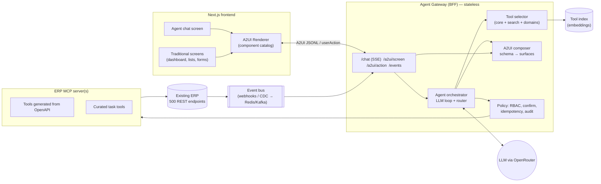
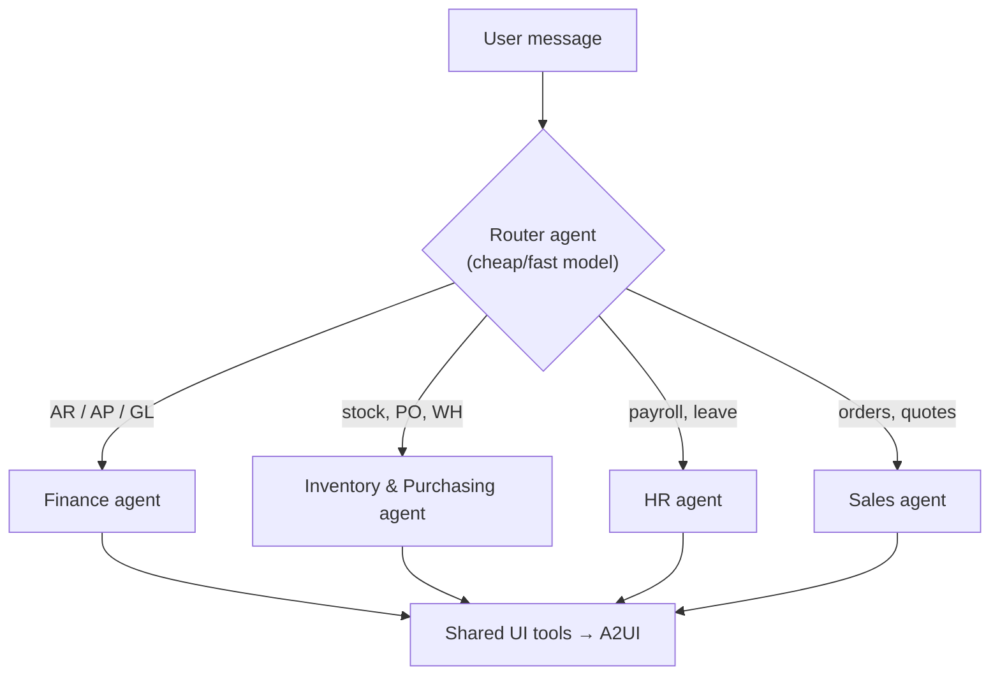
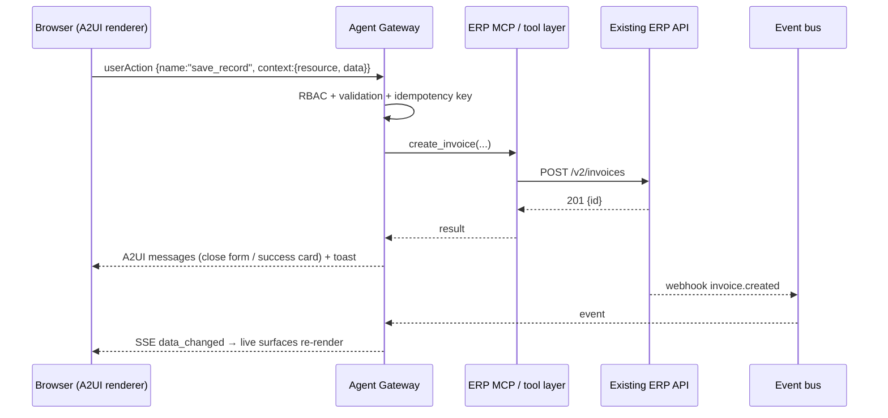

# Adding A2UI and an Agent Chat to an Existing API-Based ERP

> A scalable plan for bolting an agentic chat screen and Google A2UI generative UI onto an ERP that already exposes REST APIs (hundreds of endpoints).
> It is based on what is already built in this repo (`backend/app/agent.py`, `screens.py`, `a2ui.py`) and generalized for a large, real ERP.

---

## 1. TL;DR: the recommendation

| Question | Answer |
|---|---|
| **Where do tools run?** | **Server-side only**, in an **Agent Gateway** service. **Never in the frontend.** The frontend only renders A2UI and sends `userAction` events. |
| **MCP or built-in tools?** | **Both, layered.** Build an **ERP MCP server** generated from your OpenAPI spec as the tool layer. Your Agent Gateway is an **MCP client** of it. In v1 you can run it in-process (same code, no network hop) and split it out later. |
| **500 endpoints: how does the agent find the right one?** | Don't expose 500 tools. Curate **~40 task-shaped core tools**, put the rest behind **tool search** (`search_tools` → `call_tool`), and use **domain sub-agents** for big domains (Finance, Inventory, HR…). |
| **How is UI produced?** | Mostly by **deterministic UI tools** (`show_table`, `show_form`, `show_chart`…) that turn API data and JSON Schema into A2UI on the server. **Free-form LLM-authored A2UI** is a fallback, validated against your component catalog. |
| **Realtime?** | ERP webhooks / CDC → event bus → SSE/WebSocket → every live A2UI surface re-renders. |

---

## 2. Target architecture



**Responsibilities**

| Layer | Owns | Does NOT own |
|---|---|---|
| **Frontend** | Rendering A2UI, local form state, sending `userAction`, chat UX | Business logic, API keys, calling ERP or tools |
| **Agent Gateway** | Auth/session, LLM loop, tool selection, A2UI composition, action routing, streaming, audit | Domain rules (those stay in the ERP) |
| **ERP MCP server** | Typed tools over the ERP API, input validation, pagination, error normalization | UI, LLM prompts |
| **Existing ERP** | Source of truth, business rules, permissions | Nothing changes. **No changes to the ERP are needed.** |

---

## 3. MCP vs built-in tools vs frontend tools

| Option | Pros | Cons | Verdict |
|---|---|---|---|
| **Tools called from the frontend** | Looks simple | Leaks tokens and API surface to the browser, can't enforce policy or audit, LLM output can trigger client calls, breaks with many tabs, no server-side retries | ❌ **Avoid.** The frontend should only send A2UI `userAction`s to the gateway. |
| **Built-in (in-process) tools** | Fastest, simplest to debug, one deploy | Tied to one agent app, other agents/IDEs can't reuse them | ✅ Good for **v1**, which is what this repo does today |
| **MCP server** | Standard protocol. The same tools work in your gateway, Claude Desktop/Code, IDEs and partner agents. Deployed and scaled separately per domain. Tool discovery is built in (`tools/list`) | Extra network hop, another service to run | ✅ **Target state** for 500 endpoints and multiple consumers |

**Best of both:** write tools once against a small internal interface (`name`, `json_schema`, `handler`). Expose that registry **in-process** to the gateway *and* via an **MCP server** wrapper. You start fast and still migrate cleanly:

```python
# tools/registry.py  — single source of truth
@tool(domain="finance", kind="read", tags=["invoice", "receivable"])
async def list_overdue_invoices(ctx: Ctx, customer: str | None = None, min_amount: float = 0) -> list[Invoice]:
    """Overdue invoices, optionally filtered by customer. Use for collections / AR questions."""
    return await ctx.erp.get("/v2/ar/invoices", params={"status": "overdue", ...})

# mcp_server.py — the same registry, exposed over MCP
for t in registry.all(): mcp.add_tool(t.name, t.description, t.schema, t.handler)

# gateway — in-process OR via MCP client, chosen by config
tools = InProcessTools(registry) if settings.TOOLS_INPROC else MCPClientTools(settings.ERP_MCP_URL)
```

---

## 4. Picking the right tool out of ~500 endpoints

Sending 500 tool schemas to the LLM on every turn fails: it uses a huge number of tokens, makes the model slow and expensive, and leads to frequent wrong picks. Use **four layers**:

### Layer 1: Curate task-shaped tools (500 endpoints → ~40–80 tools)
Endpoints are shaped like CRUD; users think in tasks. Merge endpoints into tools named after the job:

| Raw endpoints | Curated tool |
|---|---|
| `GET /customers/{id}`, `GET /customers/{id}/contacts`, `GET /ar/aging?customer=` | `get_customer_360(customer)` |
| `POST /invoices`, `POST /invoices/{id}/lines`, `POST /invoices/{id}/post` | `create_invoice(customer, lines[], due_days, post=false)` |
| `GET /stock/levels`, `GET /products/{id}/reorder` | `find_low_stock(warehouse?, category?)` |

Rules for good tools:
- **Name = verb + business noun** (`approve_purchase_order`, not `post_v2_po_id_state`).
- **Description says when to use it**, gives one example, and says what **not** to use it for.
- **Inputs accept human identifiers** (`customer: "NexaCorp"`) and resolve them to IDs inside the tool, like `customer_name` does in this repo.
- **Outputs are trimmed** to the fields the model needs, with paging, totals and an `id` for each row.
- Each tool is marked `kind: read | write | destructive` for the policy layer.

### Layer 2: Generate the long tail from OpenAPI
The ~420 endpoints you don't curate are generated automatically from `openapi.json` into tools, named `{domain}.{operationId}`, with descriptions taken from `summary`/`description` and schemas from `requestBody`/`parameters`. They are **not sent to the model by default**; they are only reachable through Layer 3.

### Layer 3: Tool search (retrieval over tools)
Index every tool: name, description, tags, example prompts, and the domain path. Each turn:

1. **Always loaded (~10):** `search_tools`, `business_summary`, `show_table`, `show_form`, `show_chart`, `show_record`, `render_ui`, `ask_user`, `get_entity`, `navigate`.
2. **Retrieved:** embed the user message and conversation summary, then take the **top-k = 8–15** tools using hybrid search (BM25 + vectors), filtered by **the user's RBAC**.
3. **Self-serve:** if those aren't enough, the model calls `search_tools("credit note for returned goods")`. The next loop iteration then includes the returned tools' schemas (load on demand).

```python
def tools_for_turn(user, message, history) -> list[ToolSchema]:
    allowed = registry.filter(rbac=user.permissions)
    picked = vector_index.search(embed(message + summarize(history)), k=12, within=allowed)
    return CORE_TOOLS + picked + session.loaded_tools   # loaded_tools grows via search_tools
```

### Layer 4: Domain sub-agents (router → specialist)
For very large ERPs, a **router agent** classifies intent into a domain, and a **domain agent** that only sees that domain's 20–60 tools does the work:



Each domain agent can be its own **MCP server** (`erp-finance-mcp`, `erp-inventory-mcp`), so teams own and deploy them independently.

### What to use when
| ERP size | Approach |
|---|---|
| < 50 endpoints | All tools in the prompt (this repo today) |
| 50–300 | Curated core + tool search |
| 300+ (your case) | **Curated core + tool search + domain sub-agents** |

### Make tool selection measurable
- Build an **eval set** of 200–500 real user prompts, each labeled with the expected tool(s).
- Track the **tool-selection hit rate**, success-with-no-retry rate, tokens per task, and p95 latency.
- Re-run the eval on every tool description change. **Descriptions are prompts; version them.**

---

## 5. Integrating A2UI with an existing ERP API

A2UI is a declarative JSON protocol. The agent or server sends `surfaceUpdate`, `dataModelUpdate`, `beginRendering` and `deleteSurface` messages. The client renders them with **its own trusted component catalog** and sends back `userAction`s. No code runs from the model, which makes it safe for enterprise use.

### 5.1 Two ways to produce UI (use both)

| | **Deterministic UI tools** (primary) | **LLM-authored A2UI** (fallback) |
|---|---|---|
| How | The agent calls `show_table(resource, filters)`. The gateway fetches the data and builds A2UI from a template | The agent calls `render_ui(components)` with raw A2UI |
| Pros | Pixel-consistent, fast, cheap, live-refreshable, no hallucinated layout | Unlimited flexibility (comparisons, custom KPI boards) |
| Guardrail | n/a | **Validate against the catalog JSON Schema**, cap component count, strip unknown types |

In this repo, `show_*` tools return a **surface spec** `{screen, params}` instead of raw messages. The frontend `LiveSurface` fetches it and re-renders it on data changes. **Keep that pattern**: a spec is small, cacheable and refreshable, and it still renders after a reload.

### 5.2 Generate forms and tables from OpenAPI / JSON Schema
Don't hand-write 500 screens. Write **one mapper** from schema to A2UI:

| JSON Schema | A2UI component |
|---|---|
| `string` | `TextField(shortText)` |
| `string, format: date` | `TextField(date)` / `DateTimeInput` |
| `string, enum` | `MultipleChoice(select / chips)` |
| `number`, `integer` | `TextField(number)` |
| `boolean` | `CheckBox` |
| `$ref` to another resource | `MultipleChoice(combobox)` + lookup endpoint |
| `array` of objects | `DataTable` (custom) / `List` |
| `x-ui-*` vendor extensions | Hints: `x-ui-widget`, `x-ui-order`, `x-ui-hidden`, `x-ui-money` |

Add the `x-ui-*` hints to your OpenAPI once, and every form and table in the ERP becomes renderable by both the traditional UI and the agent.

### 5.3 Action flow (forms, buttons, row actions)



- **Action names map 1:1 to tools.** `userAction.name` goes to the action router, then a tool, so UI and agent share the same code path and policy.
- **Agent-aware actions:** an action can also be `client:ask_agent` (as on the dashboard here) or `agent:continue` to send the result back into the LLM loop, e.g. "user approved the draft".

### 5.4 Component catalog = your design system
- Keep the A2UI **standard components** (Row, Column, Card, Text, Button, TextField, MultipleChoice, Tabs…).
- Add ERP **custom components**: `DataTable`, `Metric`, `Chart`, `KeyValue`, `ApprovalCard`, `Timeline`, `DocumentPreview`, `DiffView` (for "agent proposes changes").
- Publish the catalog as a **JSON Schema**. The LLM's `render_ui` tool description includes a compact version of it, and the gateway validates against it.

### 5.5 Transport
- **Chat:** SSE over a POST stream (as built here). Events are `token`, `tool_start`/`tool_end`, `surface`, `done`.
- **Screens:** `GET /a2ui/screen?name&params` returns the A2UI messages.
- **Realtime:** one SSE/WebSocket per tab, multiplexed by topic (`invoices`, `invoices:123`).
- If you later go multi-agent across vendors, A2UI messages can also be carried over **A2A**. The renderer doesn't change.

---

## 6. Security and governance (non-negotiable for ERP)

1. **Delegated identity:** the gateway calls the ERP **as the user** (OAuth on-behalf-of / token exchange), never with a god-mode service key. The ERP's own RBAC still applies.
2. **Tool-level RBAC:** filter tools by permission **before** the LLM sees them. A tool the model can't see is one it can't misuse.
3. **Human-in-the-loop for writes:**
   - `read` runs freely.
   - `write` runs, but the result is shown, with undo where the ERP supports it.
   - `destructive` or financial (delete, post to GL, payments, payroll) **must** show an A2UI **ApprovalCard** and wait for a `userAction: approve`. The LLM cannot approve.
4. **Idempotency keys** on every write tool call, because LLM retries happen.
5. **Prompt-injection hygiene:** treat ERP text fields (notes, emails, descriptions) as data. Never let them change tool permissions.
6. **Audit log:** for each turn, store the user, prompt, tools called, args, ERP response codes, and approvals. Make it searchable for compliance.
7. **PII redaction** before sending to the LLM where policy requires it, plus per-tenant model and region routing.

---

## 7. Scalability

| Concern | Approach |
|---|---|
| Gateway scaling | Stateless pods. Conversation state in **Postgres**, hot session and tool-loading state in **Redis** |
| Long tasks (month-end close, bulk import) | Run as **background jobs** (queue: Redis/Celery, Temporal). Stream progress as an A2UI progress surface |
| Event fan-out | Redis Pub/Sub → Kafka/NATS at scale. Each gateway pod holds the SSE connections for its users |
| ERP protection | Per-user and per-tenant **rate limits**, circuit breakers, response **caching** for reads (`ETag`/short TTL) |
| LLM cost | **Model routing**: a cheap model for the router and simple reads, a stronger model for multi-step writes. Prompt caching for the system prompt and core tools |
| Context growth | Rolling conversation **summaries**. Tool results are truncated or paginated, and the UI shows the full data |
| Multi-tenant | Tenant ID in every token and tool context. Separate tool indexes per tenant if ERP customizations differ |
| Observability | OpenTelemetry traces per turn (LLM call → tool → ERP call), dashboards for tool error rate and latency, plus eval regression in CI |

---

## 8. Phased roadmap

| Phase | Weeks | Deliverables |
|---|---|---|
| **0. Foundations** | 1–2 | Gateway skeleton (copy this repo's `main.py`/`agent.py` pattern), OAuth on-behalf-of, A2UI renderer + catalog, SSE chat |
| **1. Read-only copilot** | 2–4 | 20–30 curated **read** tools, `show_table`/`show_chart`/`show_record`, schema→A2UI mapper for 5 core entities, eval set v1 |
| **2. Safe writes** | 4–6 | Write tools with idempotency, ApprovalCard, audit log, `userAction` → tool router, realtime via ERP webhooks |
| **3. Full coverage** | 6–10 | OpenAPI → generated long-tail tools, **tool search** index, `x-ui-*` hints so every entity gets forms and tables for free |
| **4. Scale-out** | 10+ | Split into **domain MCP servers** + router/sub-agents, background jobs, model routing, tenant isolation, external MCP access (Claude Desktop, partners) |

---

## 9. How this repo maps to the plan

| Plan concept | Where it lives now | Next step |
|---|---|---|
| Agent Gateway | `backend/app/main.py`, `agent.py` | Replace direct DB access with an `ERPClient` (HTTP to your existing ERP) |
| Tool registry | `TOOLS` + `run_tool` in `agent.py` | Move to a `@tool` decorator registry and add an MCP wrapper (`mcp` Python SDK) |
| Resource adapters | `resources.py` registry | Generate it from OpenAPI + `x-ui-*` instead of hand-writing it |
| A2UI composer | `a2ui.py`, `screens.py` | Add the schema→A2UI mapper, ApprovalCard, catalog JSON Schema validation for `render_ui` |
| Realtime | `events.py` (in-process) | Redis Pub/Sub, fed by ERP webhooks |
| Renderer | `frontend/src/components/a2ui/*` | Publish the catalog and add ApprovalCard/DiffView components |

**Bottom line:** keep tools **server-side**, write them **once** and expose them **in-process now and over MCP later**, never show the model more than ~25 tools at a time (**core + search + domain routing**), and have every screen, chat message and button go through the **same A2UI + action router**. Then the agent and the traditional UI stay in sync by construction.
